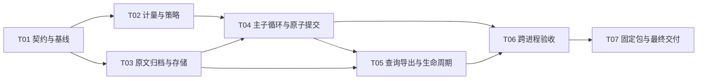

# B 方案实施任务与依赖

状态：自动实现与验证完成；T01–T06已resolved，T07自动passed/awaiting-user。最终B-r3与实际回执见delivery.md。
规格：[spec.md](spec.md)；技术契约：[plan.md](plan.md)；验收：[checklist.md](checklist.md)。
日期：2026-11-13

## 执行原则

- 原规划轮仅发布计划；后续用户已明确启动实施。文件发布不代表测试通过，实际状态按任务票及证据记录。
- 一个管理批次七张实施票，按真实依赖分段。T02/T03 可在 T01 固定共享契约后并行；持久化、权限、取消与恢复接口必须独审后供下游消费。
- 四槽上限：主协调、策略实现、存储实现、独立复核。下列负责人是未来角色，不依赖本聊天中的活动代理 ID。
- 所有实际写入前登记起点 SHA、工作区差异与文件指纹、负责分支/worktree、文件归属。既有未提交改动按块合并，不整体回退或提交。
- 日常以单票和本目录回执为准，集中交付才汇总模块对应表、验收矩阵和发布记录；历史 79/79 的范围数字不拿来计算本次新功能。

## 依赖图

## T01 — 固定契约、版本和实施基线

任务票：[03](issues/03-contract-baseline.md)。负责：主协调；依赖：无。

- 绑定当前代码与 DeepSeek 固定来源，保存脏工作区差异清单；只备份本次需要的代码，不复制真实凭据和会话。
- 固定原文逻辑身份、投影来源映射、归档批次、语义版本、操作摘要和 ArchiveRead 可见范围等唯一契约。
- 记录预算默认值、小窗口默认输出预留、显式配置优先级、失败停止差异；相应 ADR 保持“已提案/用户已确认范围”与“实现通过”分离。
- 核对旧程序的版本拒绝路径、现有数据库事务和子执行保存入口；复用现有类型模块，禁止并行分支分别发明不兼容签名。
- 固定最高验收路径及需要补充的存储故障入口。

预计文件：`src/ruocun/session/contract.py`、拟新增的归档/策略类型，以及本目录记录；先完成契约审阅再由相应实现票落地产品。

出口：接口清单、版本/兼容方案、测试入口和文件锁明确，静态/文档审查无歧义。关联 AC01、AC05、AC06、AC09、AC13、AC16。

## T02 — 统一计量与压缩候选策略

任务票：[04](issues/04-pressure-and-selection.md)。负责：策略实现；依赖：T01。

- 实现当前请求计量，复用实际输出 cap 的解析口径；可配置的压力、额外余量和近期保留预算来自同一策略。
- 实现普通工具文本的纯裁剪、完整工具组切点、近期尾部保留、旧摘要重整和必要控制材料保护。
- 候选包含选区、原文来源和预计收益，先在副本操作；策略层不直接写数据库。
- 更新摘要指令，保留事实/推断区别、关键目标与可接续状态；处理空/截断/未缩小/无法安全选区。
- 迁移已有 DeepSeek 固定来源断言与 RuoCun 失败停止差异，不扩展为新的压力基准项目。

预计文件：`src/ruocun/agent/compact.py`、`src/ruocun/agent/context_runtime.py`、摘要资源、相关上下文测试。需要修改共享请求体构造时由主协调统一接口。

出口：纯策略及请求计量定向通过，无存储副作用；候选可供 T04 消费。关联 AC01–AC04、AC11、AC12。

## T03 — 完整原文分段归档与存储确认

任务票：[05](issues/05-transcript-storage.md)。负责：存储实现；依赖：T01。**高风险接缝，独审后释放。**

- 在既有 SQLite 权威中存放按执行范围划分的不可变消息批次、归档清单和投影来源；普通保存增量归档，压缩/裁剪切换派生投影。
- 逻辑身份与正文分开；图片投递元数据变化不得误增一条用户消息，真实同文重复消息不得被合并。
- 将归档批次、来源映射和新 checkpoint/run 快照纳入同事务与幂等操作摘要；提交不明沿已有回执核实。
- 实现新语义版本门禁、显式离线备份升级、版本/哈希/引用验证；不使用外部归档文件规避事务边界。
- 备份包括数据库一致性副本及附件身份清单；不能声称单个 DB 文件包含外部附件。
- 故障复验沿现有回滚、取消等待、丢确认与 owner fencing seam；不增加独立模拟存储系统。

预计文件：`src/ruocun/session/contract.py`、`durable_store.py`、`storage_worker.py`、拟新增 `session/archive.py`、归档存储测试。共享 `contract.py` 的写入按主协调锁串行。

出口：原文/新投影同成同败、幂等、旧会话升级与旧程序拒写都有可观察证据；独审通过才允许 T04/T05 使用。关联 AC05、AC06、AC08、AC09、AC12、AC16。

## T04 — 主/子执行与统一压缩提交接线

任务票：[06](issues/06-runtime-compaction.md)。负责：策略实现＋主协调；依赖：T02、T03。**提交与取消边界需独审。**

- 主会话与同步/后台/恢复子代理共用 ContextManager 策略，经各自 journal adapter 保存；保持独立执行范围。
- 在提交锁内复核 expected projection，先确认原文与候选持久化，再交换内存投影。
- 统一自动、手动、超限与目标模型检查；未取得实际减量或提交确认时不重发超大请求。
- 保持工具配对、启动 Hook、Todo、图片投递、等待身份和未投递事件；故障时不唤醒原回合。
- 摘要、裁剪和查询用量各自如实记录；摘要模型选择沿配置，不自动更换业务主模型。

预计文件：`src/ruocun/agent/context_runtime.py`、`loop.py`、`runtime.py`、`run_agent.py`、`resume_agent.py`、`session/conversation.py` 及相关恢复测试。

出口：主/子路径的成功、失败和重开行为一致；后台与取消已有回归保持。关联 AC01–AC06、AC10–AC13、AC16。

## T05 — 只读回查、导出、分支与会话生命周期

任务票：[07](issues/07-archive-access-lifecycle.md)。负责：主协调或同一策略负责人；依赖：T03、T04。与 T04 的共享文件串行修改。

- 提供 `/archive` 列表/分页读取及 ArchiveRead 工具，绑定当前会话和执行范围。普通子代理不能继承父查询回调，fork/exactTools 不自动增加工具或历史权限。
- 默认完整导出从原文身份序列生成；提供当前投影模式，清空/回退边界明确，同文重复保持真实次数。
- clear/rewind 保存边界后只改变当前投影；branch 复制必要归档闭包及附件引用到新权威，不复制父工具副作用账本。
- 原图/日志引用按现有附件机制登记，纳入清理依赖检查；仅随所属会话封存清理，不增加独立默认 GC。
- 更新帮助、工具 schema、命令目录和安装/恢复说明，不将仅 API/源码可用的能力写成已完成终端体验。

预计文件：拟新增 `src/ruocun/tools/archive_read.py` 及资源、工具上下文/注册、命令目录、`agent/runtime.py`、`agent/run_agent.py`、`session/log.py`、`session/conversation.py`、现有清理模块、帮助资源。

出口：跨范围读取拒绝、归档可查、完整导出无重复、分支引用闭合、清理保护有效。关联 AC07–AC10、AC12–AC14、AC16。

## T06 — 普通产品入口跨进程验收

任务票：[08](issues/08-entry-acceptance.md)。负责：未实现对应产品接缝的验证角色；依赖：T04、T05。

- 扩展现有普通会话命令的本地 HTTP/SSE fixture，制造真实多轮、工具输出和至少两次压缩。
- 捕获实际请求，证明近期原文保持、旧摘要重整、纯裁剪可跳过摘要；关闭后用第二进程重开、读取和导出原文。
- 复用已有后台等待、图片、子执行、分支与恢复用例覆盖受影响行为；故障点只补足原子归档需要的最小确认。
- 所有测试使用白名单和合成状态，日志审查后留证；不调用真实模型，不读真实用户配置/记忆。

预计文件：现有上下文/会话/后台/子代理测试及必要的新归档验收文件；不写第二套产品入口。

出口：C01–C14、C16 对应自动技术结果可追踪，失败原文保留，独立复验无阻断。关联 AC01–AC14、AC16。

## T07 — 固定候选构包、独审与交付

任务票：[09](issues/09-release-verification.md)。负责：主协调＋独立复核；依赖：T06。

- 收敛一个固定源码候选，集中运行所选范围全量、Ruff、Mypy、已有离线验收及标准包构建，禁止每张票重复整套构包。
- 在仓库外纯安装环境确认实际模块/资源/版本，执行普通产品的压缩、重开、回查和导出；绑定包和源码字节/哈希。
- 更新来源归属、必要许可、ADR、模块对应表、验收矩阵和发布说明。
- 新命令真实 Windows Terminal 的显示、长文本分页和缩放安排为最终一次集中技术验证；用户体验保持 pending，不能由无头测试回填 accepted。
- 保存技术出口、已知限制、升级/备份/回退指引。无明确费用授权时真实模型质量保持未验。

出口：可安装候选和独审回执齐全；自动出口与体验出口分开记录。关联 AC15，汇总 AC01–AC16。

## 任务状态与交付规模

| 任务 | 票 | 初始状态 | 前置 |
|---|---|---|---|
| T01 | 03 | ready-for-agent | 无 |
| T02 | 04 | blocked | 03 |
| T03 | 05 | blocked | 03 |
| T04 | 06 | blocked | 04、05 |
| T05 | 07 | blocked | 05、06 |
| T06 | 08 | blocked | 06、07 |
| T07 | 09 | blocked | 08 |

上一轮估算为净新增产品约 1000–1600 行、测试约 700–1100 行、修改既有约 200–350 行。归档身份、兼容与子执行接线在 T01 绑定后重新核算；估算不是正确性上限，也不把复制的来源文件或文档算作产品代码。

计划不承诺固定小时数。先交付 T03 的耐久契约，再交付可回查的 T04/T05，最后集中完成 T06/T07；每个保存点均可明确报告已实现、自动结果及待验项。
