# 本轮实现任务依赖图

当前范围保留原02–85共84个编号，有效79票。完成与认领状态读取实施进度及逐票记录。20 NotebookEdit、37自定义Markdown命令、50组合插件、75成套真实模型评分及80独立程序均标为`scope: excluded`。最新完成和派发见[实施进度](implementation.md)。[ADR-0010](../../docs/adr/0010-selected-scope-and-lean-workflow.md) · [ADR-0014](../../docs/adr/0014-terminal-and-scope.md)

任务状态以各票为准，拓扑来自`task-graph.json`。灰色节点及其入边记录历史前置。70移除原50的插件前置，79移除原20的NotebookEdit前置。37到50仍为两个移出节点之间的历史边。76仍直接依赖71/73/74，81继续依赖79。

58依赖07的私密文件能力，85依赖77/78完整人工验收。79依赖78的自动技术出口，84依赖77的自动技术出口。批次08已验证两项自动出口，当前候选的有效状态由 `issue_graph.py` 核对。派发前按当前范围过滤20/37/50/75/80。

17的查询、resolve和decide可在16/10之后实施；完整continue还实际消费40后台代理、39定义校验和41恢复现场边界。整票依赖已补齐，不能用“dispatcher未装配”的拒绝证明完整continue通过。40不依赖17，接续方向为38→40/39→41→17收口；本批独立切片不提前解锁17的下游。

沙箱继续按ADR-0008：Windows显式启用不支持，额外原生后端不重开。W3/W5/W6缩减后，59/62/63仍须交付能力路由、不支持说明及终端提示，取消后端不等于三票完成。

70另依赖22/23/42：全部CLI与隔离入口实际消费Web和反思能力；71经70继承，不以参数解析或空注册替代实现。

```mermaid
flowchart TD
  I02["02 隔离运行冻结参考并生成一条可比对轨迹"]
  I03["03 安装开发包并从仓库外调用ruocun"]
  D11 --> I03
  D21 --> I03
  I04["04 用兼容账户配置完成首轮流式对话"]
  I03 --> I04
  I02 --> I04
  D08 --> I04
  D09 --> I04
  I05["05 通过Responses路由完成同一对话/工具回合"]
  I04 --> I05
  I06["06 模型断流/限流后可重试或可靠停止"]
  I04 --> I06
  I07["07 保存一次会话并拒绝并发owner写入"]
  I04 --> I07
  I08["08 模型用TodoWrite和Read完成首个工具回合"]
  I07 --> I08
  I09["09 按分层权限审批并完成一次文件写入"]
  I08 --> I09
  I10["10 编辑文件并在崩溃后识别未知副作用"]
  I09 --> I10
  I11["11 忙时排队、暂停及取消流不会污染新轮"]
  I08 --> I11
  I06 --> I11
  I12["12 混合工具批次保持并发上限与写屏障"]
  I10 --> I12
  I11 --> I12
  I13["13 Shell命令按实际方言审批后执行"]
  I09 --> I13
  D10 --> I13
  I14["14 前台Shell输出及整个受管进程树可取消"]
  I13 --> I14
  I11 --> I14
  I15["15 Shell转后台后可重连、读输出和停止"]
  I14 --> I15
  I16["16 后台事件持久投递并以TaskWait唤醒"]
  I15 --> I16
  I17["17 恢复查询及显式决定解开未知工具/执行"]
  I16 --> I17
  I10 --> I17
  I40 --> I17
  I39 --> I17
  I41 --> I17
  I18["18 在真实WT边流式边编辑并中断/缩放"]
  I11 --> I18
  D10 --> I18
  I19["19 模型浏览与搜索项目文件"]
  I08 --> I19
  I20["20 模型修改Notebook单元并保存合法文档"]
  I10 --> I20
  I21["21 终端/REPL问题与用户消息可往返"]
  I11 --> I21
  I22["22 模型按权限抓取URL并抽取内容"]
  I09 --> I22
  I23["23 模型搜索网页并返回受限结果"]
  I09 --> I23
  I24["24 自动权限分类失败时保守询问并留审计"]
  I09 --> I24
  I25["25 通过工具和命令调整配置并影响后续轮"]
  I09 --> I25
  I26["26 继续/切换/分支/命名和导出聊天"]
  I11 --> I26
  I27["27 在worktree修改文件并用检查点回退"]
  I10 --> I27
  I28["28 多模型用量与本次运行费用/预算"]
  I07 --> I28
  I05 --> I28
  I29["29 上下文压缩及模型错误后继续任务"]
  I08 --> I29
  I28 --> I29
  I30["30 工具写入/查询/审核删除分域记忆"]
  I09 --> I30
  I31["31 恢复/新轮按项目加载并注入记忆"]
  I30 --> I31
  I11 --> I31
  I32["32 蒸馏合并清理记忆并保留来源和锁定项"]
  I31 --> I32
  I33["33 模型按预算读取和刷新代码图"]
  I19 --> I33
  I11 --> I33
  I34["34 加载技能及8个core技能并按需调用"]
  I08 --> I34
  I35["35 文件访问动态激活/禁用条件技能"]
  I34 --> I35
  I19 --> I35
  I11 --> I35
  I36["36 安装外部技能后立即调用与适配"]
  I34 --> I36
  I09 --> I36
  I37["37 自定义Markdown命令在TTY展开并续轮"]
  I18 --> I37
  I38["38 调用内置子代理并收集同步结果"]
  I34 --> I38
  I09 --> I38
  I39["39 自定义代理定义约束真实派发"]
  I38 --> I39
  I31 --> I39
  I40["40 后台代理可查询、停止并从checkpoint继续"]
  I38 --> I40
  I16 --> I40
  I41["41 fork/exactTools及可准确恢复的现场边界"]
  I40 --> I41
  I39 --> I41
  I27 --> I41
  I42["42 长任务触发反思并在恢复后继续"]
  I32 --> I42
  I29 --> I42
  I41 --> I42
  I43["43 批量派发代理并双向追加消息"]
  I40 --> I43
  I39 --> I43
  I44["44 内置命令与长任务目标驱动后续工具轮"]
  I18 --> I44
  I29 --> I44
  I41 --> I44
  I43 --> I44
  I45["45 创建/查询/更新/停止手工任务记录"]
  I40 --> I45
  I46["46 Monitor输出事件可观察并可靠停止"]
  I45 --> I46
  I47["47 会话loop按周期排队且退出清理"]
  I18 --> I47
  I48["48 Hook拦截/改写一次工具调用并参与journal"]
  I10 --> I48
  I24 --> I48
  I14 --> I48
  I49["49 代理启动/停止及会话Hooks不重复注入"]
  I48 --> I49
  I39 --> I49
  I40 --> I49
  I50["50 安装一个组合插件后使用并安全卸载"]
  I36 --> I50
  I37 --> I50
  I39 --> I50
  I48 --> I50
  I51["51 模型调用stdio MCP工具并得到结果"]
  I09 --> I51
  I52["52 同一MCP能力经HTTP/SSE连接并可关闭"]
  I51 --> I52
  I53["53 搜索激活工具并消费MCP资源/提示更新"]
  I51 --> I53
  I21 --> I53
  I54["54 MCP不确定结果断线后不盲目重做"]
  I52 --> I54
  I53 --> I54
  I17 --> I54
  I55["55 模型在Windows正确导航代码位置"]
  I09 --> I55
  I56["56 外部Deck面板控制同一持久会话"]
  I16 --> I56
  I57["57 查看脱敏审计与可选观测轨迹"]
  I28 --> I57
  I12 --> I57
  I58["58 Windows系统凭据存取及fallback可用于请求"]
  I04 --> I58
  I07 --> I58
  I59["59 系统定时来源路由与Windows不支持边界"]
  I14 --> I59
  I60["60 沙箱按来源路由并准确报告平台能力"]
  I14 --> I60
  I61["61 网络隔离开关保持来源语义与平台限制"]
  I60 --> I61
  I22 --> I61
  I62["62 电源能力路由与Windows无防休眠保证"]
  I15 --> I62
  I63["63 终端通知及标题注意状态（无桌面通知）"]
  I16 --> I63
  I64["64 Windows粘贴图片进入视觉模型请求"]
  I18 --> I64
  I05 --> I64
  I65["65 内联转录、中英文主题及scrollback稳定"]
  I18 --> I65
  I66["66 在终端审批/回答问题并选择账户或技能"]
  I65 --> I66
  I21 --> I66
  I24 --> I66
  I35 --> I66
  I58 --> I66
  I67["67 任务面板/历史展开与Ctrl+B后台操作"]
  I65 --> I67
  I45 --> I67
  I47 --> I67
  I68["68 欢迎Sixel/终端回包与文本降级稳定"]
  I65 --> I68
  I63 --> I68
  I69["69 首次终端引导完成账户/语言/信任配置"]
  I66 --> I69
  I70["70 全部CLI参数/slash按入口正确路由并收尾"]
  I44 --> I70
  I26 --> I70
  I25 --> I70
  I53 --> I70
  I55 --> I70
  I69 --> I70
  I67 --> I70
  I59 --> I70
  I57 --> I70
  I71["71 eval及禁用开关贯穿启动/文件访问/恢复"]
  I22 --> I70
  I23 --> I70
  I42 --> I70
  I70 --> I71
  I54 --> I71
  I72["72 运行一个评估任务并生成可评分轨迹"]
  I70 --> I72
  I73["73 执行记忆/缓存验收并生成脱敏报告"]
  I32 --> I73
  I72 --> I73
  I74["74 执行反思验收并识别正控/失败"]
  I42 --> I74
  I72 --> I74
  I75["75 来源成套真实模型评分（本轮移出）"]
  I71 --> I75
  I73 --> I75
  I74 --> I75
  I76["76 离线运行时/协议验证后台、恢复与扩展"]
  I71 --> I76
  I73 --> I76
  I74 --> I76
  I49 --> I76
  I46 --> I76
  I77["77 最终产品完成Windows Terminal真实操作验收"]
  I71 --> I77
  I68 --> I77
  I64 --> I77
  I62 --> I77
  I78["78 本轮Windows能力及不支持边界最终验证"]
  I58 --> I78
  I59 --> I78
  I61 --> I78
  I62 --> I78
  I63 --> I78
  I64 --> I78
  I17 --> I78
  I79["79 构建并在隔离环境安装完整wheel/sdist"]
  I71 --> I79
  I33 --> I79
  I78 --> I79
  I23 --> I79
  I56 --> I79
  I68 --> I79
  I80["80 Windows独立产物（本轮移出）"]
  I79 --> I80
  I81["81 Python包手动安装升级及数据保留"]
  I79 --> I81
  I82["82 各平台按支持矩阵运行质量/构建门禁"]
  I79 --> I82
  I83["83 交付可重建产物、使用恢复文档和许可清单"]
  I81 --> I83
  I82 --> I83
  I84["84 Python安装产物跑本轮Windows集成门禁"]
  I76 --> I84
  I77 --> I84
  I81 --> I84
  I82 --> I84
  I85["85 核验本轮覆盖并完成用户交付验收"]
  I84 --> I85
  I83 --> I85
  D14 --> I85
  I77 --> I85
  I78 --> I85
  classDef excluded fill:#eeeeee,stroke:#999,stroke-dasharray:5 5,color:#666
  class I20,I37,I50,I75,I80 excluded
```

