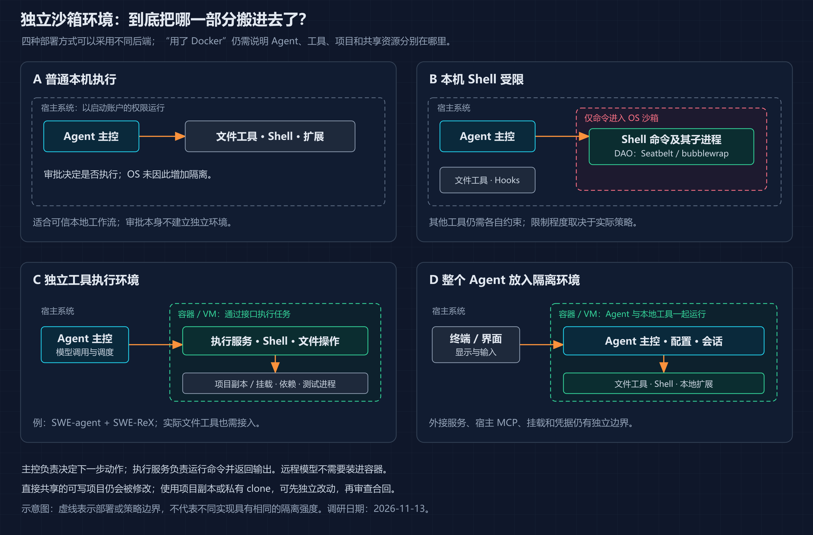

# GitHub 编码代理沙箱调研报告

调研日期：2026-11-13（北京时间）。对象：DAO／若存这种个人或小团队维护、单机使用、具有文件工具、Shell、扩展和后台任务的编码代理。本报告先解释独立执行环境，再比较七个有代表性的开源项目；源码与文档核查不等于本机运行验收。

**最终状态：研究与讨论已收口。** 用户确认若存沙箱保持现状，暂不做 Docker 或 Windows 沙箱改造，见 [ADR-0019](../../docs/adr/0019-learning-oriented-sandbox-goal.md)。本报告的外部项目事实和历史候选继续留档；候选实验、平台移植与后端改造均不作为当前待办。

**先给你明确判断。**

1. 编码代理的执行环境里，常见的是查代码、改文件、安装依赖、编译、运行测试、检查差异，以及启动临时服务。它主要围绕“一个代码仓库能不能正确工作”展开，不必天然具备操作 Windows 桌面、注册表或本机所有软件的能力。
2. 本次样本没有呈现一种统一默认：mini-swe-agent、pi、OpenCode 的本机入口可以直接使用宿主环境；Gemini CLI 提供可选隔离；SWE-agent 默认使用 Docker 执行后端；OpenHands 当前入口又同时提供本机和 Docker 部署。不能把这些例子说成“同规模项目大多数都用 Docker”。
3. 研究曾提出在独立环境中验证整套代理的候选路线。后续源码核对确认当前若存不能直接迁入 Linux Docker；用户最终选择保留现有沙箱，本轮不采纳该路线。
4. Windows 电脑可以承载 Linux 容器或 Linux 虚拟机，但其中执行的是 Linux 工作负载。如果首要任务依赖 Windows 专属程序、桌面或系统 API，需要另外评估 Windows 原生隔离；不能把操作系统兼容和安全隔离当成同一个问题。

2026-11-13 后续源码核查更正：上述第 3 条是架构候选，不能理解为当前若存直接放进 Linux Docker 就能运行。正式普通会话有 Windows SQLite 运行库与进程身份门禁，可恢复 Shell 也限定 Windows；仅关闭后台不足以获得可运行的 Linux 正式入口。具体约束及低复杂度替代路线见[沙箱简化方案](../sandbox-simplification-20261113/proposal.md)。

以上第 1 条来自样本工具与教程的共同任务形态，第 2 条是本次查到的项目事实，第 3 条记录候选与最终取舍。后文分别给出依据。

**先用一次修 Bug 的任务理解“里面跑什么”。**

假设你让若存修复一个 Python 项目的失败测试。下面是示意流程，并非本次真实执行记录：

| 步骤 | 谁做什么 | 对环境有什么要求 |
|---|---|---|
| 读题与找代码 | 代理读取项目文件、搜索函数和调用点 | 能访问这份项目代码 |
| 修改实现 | 文件工具编辑源文件 | 能写入指定工作目录 |
| 准备依赖 | 执行 `pip install` 等安装动作 | 有 Python、包管理器、缓存和必要网络 |
| 验证行为 | 执行 `pytest`，读取错误，再继续修改 | 能启动进程、接收输出、判断退出结果 |
| 审阅改动 | 查看 `git diff`，核对修改范围 | 有 Git，保留用户可检查的结果 |

换成 Java，主要动作可能是准备 JDK 与 Maven，再执行 `mvn test`；换成 Node，可能是安装依赖、构建、测试和启动预览服务。SWE-agent 的官方教程就是从修 GitHub Issue、本地仓库 Bug 和准备依赖镜像展开；OpenHands 的基础工具也包括终端、文件编辑和任务跟踪。[SWE-agent 教程][swe-tutorial]、[OpenHands SDK 示例][oh-readme]

这里有一个容易混淆的参与者：远端模型服务负责根据请求生成下一步动作；真正执行 `pytest` 的是你的电脑、容器或远端执行服务器。使用云端模型不自动意味着代码也在云端运行；执行环境放在哪里，是代理系统另外安排的。

对 DAO／若存来说，常见的执行能力可以分成四类：

| 类型 | 例子 | 独立 Linux 环境的适合程度 |
|---|---|---|
| 项目开发 | 查找、修改、测试、编译、格式化 | 通常适合，前提是项目及依赖支持 Linux |
| 配套服务 | 临时 Web 服务、测试数据库、浏览器测试 | 可以支持，需要安排端口、进程和数据生命周期 |
| 交付动作 | 创建提交、推送、部署、调用外部服务 | 技术上可能执行，但还需要单独的权限和授权安排 |
| 本机系统操作 | Windows 桌面、注册表、Windows 专属驱动或程序 | 普通 Linux 容器不能自动提供同样的原生能力 |

这张表是任务分类，不是各类任务的实际使用比例。开源项目的工具列表与示例可以证明“能做什么”，无法证明全球用户每天主要做哪一类。

**独立环境究竟独立了什么。**

宿主机就是承载执行环境的电脑；对你而言，通常是日常使用的 Windows。镜像是预先准备的文件系统与软件模板，例如一套已经装好 Python、Git 和测试依赖的 Linux 环境。容器是从这个模板启动的一次运行实例，里面有自己的进程和工作目录。虚拟机则还提供独立的操作系统内核；microVM 是采用虚拟化边界、面向较精简工作负载的虚拟机形态。

于是，一个独立执行环境至少要回答：项目文件怎么进去，编译器和依赖在哪里，命令在哪里运行，能连接哪些网络，结束后哪些结果保留。Docker 的文件挂载可以把宿主目录直接交给容器，容器里的修改会同步影响原目录；也可以先复制或克隆项目，让代理只改副本。它们的开发体验与保护范围不同。[Docker 目录挂载][docker-mounts]

图中 A 是本机直接执行；B 是只给 Shell 增加系统限制；C 是主控留在外面、工具在独立环境执行；D 是代理本身也进入容器或虚拟机。图为机制示意，不表示所有项目都严格落在单一模式，远端 MCP 等集成仍可能跨越边界。

**这些东西都有用，但提供的作用不同。**

| 做法 | 直接解决的问题 | 不能仅据此推出的保证 |
|---|---|---|
| 命令审批 | 决定这次动作是否获准执行 | 获准以后进程只能访问某些文件 |
| Git 分支／worktree | 组织代码改动、分离工作目录、便于审阅 | 进程无法读取或修改工作目录外的内容 |
| Python `venv` | 分离 Python 包和解释器依赖 | Python 进程没有宿主文件或网络权限 |
| WSL | 在 Windows 中提供 Linux 运行环境 | Agent 自动被限制到一个项目，不能通过互操作访问宿主资源 |
| Seatbelt／bubblewrap | 对进程施加文件、网络等系统限制 | 每个调用方都使用了同样严格的策略，或代理所有工具都已被包住 |
| 普通 Docker 容器 | 独立文件系统和进程环境，并可配置资源与网络 | 可写挂载不会影响宿主，或容器存在就足以承担任意多租户安全承诺 |
| VM／microVM | 增加独立内核的虚拟化边界 | 显式共享目录、网络和外部工具不会产生副作用 |

例如，审批允许执行 `pip install`，只说明可以执行这个动作；虚拟环境决定包安装在哪一套 Python 依赖目录；沙箱再决定进程能看到和写入什么。三者可以一起使用。Docker 官方也把命名空间、资源控制和 daemon 权限分别讨论，而没有把它们归成一个单独开关。[Docker 安全模型][docker-security]

**七个项目实际采用了什么。**

选样依据是执行形态和工程职责。前三个更接近个人本地 CLI；Gemini 与 Anthropic 的运行时用于观察成熟的可选后端；SWE-agent 与 OpenHands 用于观察独立执行环境。没有用 Star 数或代码行数判断规模，也没有把平台型项目当成若存必须照搬的架构。

| 样本及本次查看的入口 | 默认或明确边界 | 独立环境方案 | Windows 相关结论 |
|---|---|---|---|
| mini-swe-agent：`mini` CLI | 默认 Local，直接本机执行 | 可选 Docker；bubblewrap 为实验性 Linux 后端 | Docker 可承载 Linux 任务，不能据此声称原生 Windows 命令已隔离 |
| pi coding-agent | 默认继承运行账户的宿主权限 | 官方区分整进程隔离与工具级隔离，列出容器方案 | 原生 Windows 有 Git Bash 路线，WSL 中则使用 Linux 环境 |
| OpenCode：当前 V2／dev 源码 | 官方明确不提供内置沙箱；权限用于交互控制 | 建议需要隔离时放进容器或 VM | 有 Windows 产物；能运行不代表已有 OS 沙箱 |
| Gemini CLI：稳定版 v0.68.0 | 沙箱默认未开启 | 可选容器及平台原生后端 | 已有可选 Windows-native 路径，限制与副作用须分别核查 |
| Anthropic sandbox-runtime，另核对 Claude 产品 | 运行时库提供隔离能力；Claude 产品默认不开启 | macOS Seatbelt、Linux bubblewrap 与网络代理 | 运行时库有原生 Windows alpha；Claude 产品的公开支持边界不能由此推定 |
| SWE-agent | 默认 Docker deployment | 宿主主控通过 SWE-ReX 与容器内执行服务器交互 | FAQ 声称三平台可用，取决于环境镜像等条件 |
| OpenHands：当前 Canvas／SDK | 当前本机入口可直接运行；Docker 为显式选择 | DockerWorkspace 在容器中运行 agent-server | 当前文档给出 PowerShell 和 WSL2 入口；不要套用旧版安装结论 |

**mini-swe-agent：小型代理也可以同时提供本机和 Docker。**

这与若存最有可比性的一点是：主循环保持较小，把“命令在哪里运行”抽成环境接口。当前 `mini` CLI 的默认环境是 Local，官方文档明确提醒没有隔离；Docker 是可以选择的另一种环境。Docker 实现通过容器执行命令，bubblewrap 后端则明确是实验性、仅 Linux。这证明“支持 Docker”与“默认必须 Docker”可以分开。[环境说明][mini-env]、[实际默认值][mini-default]

它的配置提示围绕定位问题、复现、修改和测试展开。对若存的启发是保留一套代理流程，通过可选执行环境承载不同任务，而不是复制出两套 Agent。[任务提示配置][mini-config]

**pi：官方把整进程容器化作为一条独立使用路线。**

这里核对的是 coding-agent，不是同一仓库中其他可能带有不同沙箱机制的组件。其安全说明直说默认拥有宿主运行账户的权限，并区分整个进程的隔离和通过扩展替换工具执行。容器化文档列出普通 Docker、Docker Sandboxes 等方案；普通 Docker 是较直接的整进程边界。[安全说明][pi-security]、[容器化说明][pi-container]

它在 Windows 上提供 Git Bash 路线，也可通过工具使用 PowerShell；在 WSL 中启动则进入 Linux 环境。由此可以看到：终端窗口使用 Windows Terminal，并不决定代理内部一定执行 Windows 命令。[Windows 说明][pi-windows]

**OpenCode：审批系统可以存在，OS 沙箱仍可以缺席。**

当前查看的是 V2／dev 源码快照，不把它当成每位用户已经安装的稳定版本。其 `SECURITY.md` 明确说明不内置沙箱，权限机制用于交互；需要执行层隔离时，应由容器或虚拟机承担。这个样本适合帮助理解“有权限规则”与“有系统边界”的区别。Windows 产物的存在也不改变这一点。[安全声明][oc-security]、[权限文档][oc-permissions]、[Windows 产物][oc-windows]

**Gemini CLI：可选原生后端和容器可以并存。**

稳定版 v0.68.0 的配置代码中，未配置沙箱就不会自动启用；单工具沙箱开关的默认值也是关闭。[默认解析][gemini-default]、[单工具开关][gemini-tool-default] 文档既描述 Docker／Podman 这类运行环境，也区分整个 CLI 进入沙箱与逐工具执行的模式。可以借鉴其后端选择方式，但这不意味着若存应该复制它全部的配置系统。[沙箱文档][gemini-sandbox]

本次还核实到该稳定版已经包含可选 Windows-native 路径，不能继续说“开源编码代理都没有 Windows 原生沙箱”。但是其文档提示 Low Integrity 标签的持续影响，部分网络限制路径还存在失败警告，不能将“源码里有后端”写成“Windows 所有隔离能力已经成熟并严格等价”。[Windows 行为说明][gemini-windows]

**Anthropic：共享运行时库的能力不等于产品已经全部开放。**

官方 sandbox-runtime 使用 macOS Seatbelt、Linux bubblewrap，并结合代理限制网络。具体策略决定读写与网络范围：它不是简单把所有宿主文件隐藏起来。当前库 v0.0.83 又提供原生 Windows alpha，涉及专用本地账户、Token、ACL 和 WFP，以及一次需要提权的安装步骤。默认安装还会给专用账户授予用户 profile 的部分读取权限，并排除凭据存储等位置；这类宿主账户和权限变更需要作为方案成本单独评估。[运行时机制][srt-mechanism]、[Windows alpha][srt-windows]

但 Claude Code 产品自己的文档仍把可用范围写为 macOS、Linux、WSL2，并说明原生 Windows 命令不在沙箱内。它的 Bash 沙箱也不能自动代表 Read／Write／Edit、MCP、Hooks 和 LSP 都被同一层系统机制覆盖。引用时必须分别说明“库里已经有什么”和“产品入口承诺什么”。[Claude Code 产品说明][claude-sandbox]

**SWE-agent：把执行后端独立出来，比逐条包装命令更完整。**

默认配置创建 Docker deployment。Agent 主控处理模型与历史，SWE-ReX 服务器在容器内维护 Shell 会话；文件读写也通过该运行时完成。这接近图 C，而不是“只有 Bash 使用容器，文件工具仍直接操作宿主”的半套边界。[默认环境][swe-default]、[架构][swe-arch]、[运行时文件工具][swe-files]

它准备镜像依赖、复制本地仓库，在隔离环境里修 Issue、运行测试，形成可带回的修改。Windows／macOS／Linux 是官方 FAQ 声称的宿主支持范围，仍受镜像可用性等条件影响；不能解读为它在容器内原生执行 Windows 系统工作流。[教程][swe-tutorial]、[平台 FAQ][swe-faq]

**OpenHands：必须根据当前入口判断，旧印象很容易出错。**

当前主仓主要承载 Agent Canvas；SDK、工具、Agent Server 和工作区能力归 software-agent-sdk。当前 Canvas 文档说明 npm／npx／桌面入口可以直接在本机工作，Docker 是需要清楚文件边界时的显式选项；SDK 的普通 Workspace 工厂默认也返回 LocalWorkspace。[当前入口说明][oh-setup]、[SDK 分工][oh-readme]、[默认工作区][oh-local]

选择 DockerWorkspace 时，它会启动 agent-server 容器，再提供远程工作区能力。现行代码显式处理挂载、端口、环境和停止容器。沙箱专页仍有“Docker 默认”的文字，但混有 legacy 部署语境，不应覆盖新版所有入口。这里最值得若存学习的是区分本机使用体验与独立环境的生命周期，不是搬来整个平台。[DockerWorkspace 实现][oh-docker]、[不同语境的沙箱专页][oh-sandbox-doc]

**普通 Docker 与 Docker Sandboxes 是两个不同候选。**

普通 `docker run` 启动容器，Linux 容器共享承载它的 Linux 内核；在 Windows Desktop 中，这个内核由相应后端提供。文件边界取决于挂载，网络也要另配。Docker daemon 控制权较大，因此不能把任意容器参数或宿主 Docker socket 交给本来想限制的 Agent。[Docker 安全模型][docker-security]、[Windows 后端][docker-wsl]

Docker 现在还提供专门面向 AI 代理的 Docker Sandboxes 产品，当前使用独立 `sbx` CLI。其本地方案以 microVM 为主要边界，VM 内有独立 Docker Engine；可以选择直接共享工作树，或采用只读来源仓库加私有克隆的方式。它还有网络与凭据代理，不能与普通 Docker 命令画等号。[产品安全模型][sbx-security]

截至本轮核查，`sbx` v0.53.0 发布于 2026-11-11；安装文档列出 Windows 11、x64 和 Windows Hypervisor Platform 等本地条件，并说明使用 `sbx` 不必先安装 Docker Desktop／Engine。自定义 Kits 仍标注 Early Access，可以包装新的 Agent；DAO／若存的适配仍需验证，不能假设已有开箱入口。[安装要求][sbx-install]、[固定版本发布][sbx-release]、[自定义 Kits][sbx-kits]

它也不是“所有动作都在 VM”：官方明确本地 stdio MCP 可以运行在宿主，通过 gateway 提供能力。这再次说明，隔离环境与可信外部集成要分别看。报告把它列为值得比较的新候选，不代表已经在你的机器上验证或建议立即安装。

**若存的当前决定与历史候选。**

若存当前是 Python 实现、Windows Terminal 优先的单机编码助手，已有文件工具、Shell、扩展、后台任务与恢复机制。它不是面向陌生用户开放任意代码的托管服务。当前沙箱按来源保留 macOS／Linux 可选后端，Windows 不支持；Windows 默认 Shell 实际为 `cmd.exe`，不是只要界面在 PowerShell 窗口里，就自动成为 PowerShell 执行。[项目定位](../../CONTEXT.md)、[沙箱实现](../../src/ruocun/platform/sandbox.py)、[Shell 计划](../../src/ruocun/platform/shell_plan.py)

当前决定是保留现有沙箱。下表是研究时的阶段候选，本轮未采纳，保留用于回查取舍：

| 阶段 | 建议完成的具体事情 | 由此回答的问题 |
|---|---|---|
| 学习与需求验证 | 先选择保留 Windows 的外层环境，或明确需要平台适配的 Linux 学习版，再用项目副本验证改码、测试与审阅 | 你是否接受平台取舍、工具链和环境管理成本 |
| 选择使用边界 | 对比“直接改共享目录”和“先改副本，再审阅带回” | 你更需要即时同步，还是保护日常工作树 |
| 若决定内置 | 增加可选执行后端，保留本机入口；统一命令与文件工具需要的执行边界 | 是只限制 Shell，还是形成覆盖工具的独立环境 |
| 若必须 Windows 原生 | 单独评估 Windows-native、专用账户或 Windows VM 等路线 | 哪些原生工具必须保留，什么兼容代价可以接受 |

这些候选验证均未执行，不是当前后续安排。普通 Docker 与 microVM 的差异仍有学习价值；若将来用户提出新的明确需求，可以回查，但不自动重启评估或安装流程。

进入开发时，若存已有的取消和恢复行为尤其重要。容器方案要记录真实容器及执行标识，确认命令和子进程已停止，处理输出、退出结果、网络、HOME、缓存与会话持久化；只记录宿主 Docker 客户端的 PID 不足以代表容器里的运行状态。请求隔离却启动失败时，也应清楚失败，不能静默退回宿主执行。这些是对现有行为的兼容要求，不是为本次报告新增开发任务。

用户最终确认继续使用现有 DAO 式轻量 Shell 沙箱，Docker 与 Windows 沙箱改造暂缓；原有运行与恢复能力保留。[当前决定](../../docs/adr/0019-learning-oriented-sandbox-goal.md)

**前面讨论中需要校准的认识。**

- “同规模一般都用 Docker”没有得到统计证据。样本展示了多种实际做法；选择更受任务、自主程度、兼容性与使用入口影响。
- “Windows 没有原生沙箱”过于绝对。Windows 自身有隔离机制，当前开源运行时也出现了原生后端；某个项目没有接入，是该项目的能力边界。
- “整个 Agent 进容器”与“主控在外、完整工具执行在内”都能形成清楚边界；“只包装 Shell”覆盖范围较窄，要单独说明文件工具与扩展在哪里执行。
- “Docker 能隔离”还要结合实际挂载、网络、daemon 权限和可信集成。它不会阻止对已共享可写项目的修改。
- OpenHands 的旧默认、新版 Canvas 的本机入口、显式 DockerWorkspace，以及 Docker Sandboxes 专用产品，必须分别描述。

**讨论收口。**

此前关于首个验证任务、项目副本、Windows 原生能力和内置执行后端的问题，随用户选择暂不改造而关闭，不再等待回答。研究证据和隔离边界说明保留，未产生产品实施或体验验收任务。

**证据快照与研究限制。**

| 仓库或发布 | 本次使用的固定版本／提交 | 备注 |
|---|---|---|
| SWE-agent/mini-swe-agent | `04d809ceab9df28f9adaed044884180159172930` | main，2026-09-03；结论限定 mini CLI |
| earendil-works/pi | `d36266e06669c6991a7c9509d1da04d18d30378d` | 原 badlogic/pi-mono 路径已重定向；限定 coding-agent |
| anomalyco/opencode | `7e441d348ea0dc951e470dbd84d6c3a0df34aa9a` | 当前 V2／dev 源码快照 |
| google-gemini/gemini-cli | `5a5c7180ff3f0a02511f54b54db7f228d4982a30` | 稳定版 v0.68.0，2026-11-10 |
| anthropics/sandbox-runtime | `0bbebed0aa9a8e628dc4df8bc30293550a1988eb` | v0.0.83；Windows alpha 与 Claude 产品分开 |
| SWE-agent/SWE-agent | `3ea751c087f32b16e039a2233dd6eefecef325d5` | main，2026-07-16 |
| SWE-agent/SWE-ReX | `5c995c365dfb1fd5bc56fda688be5d8538f9931f` | main，2026-03-02；实际执行后端 |
| OpenHands/OpenHands | `754abee4f0869dfc85dbd0acb6457f2e0ad17d4c` | 当前 Agent Canvas 主仓 |
| OpenHands/software-agent-sdk | `84ae396c3cfc3ecb35d7388547f10167b477771d` | SDK／工具／Agent Server／工作区 |
| OpenHands/docs | `edd916fa067340abd55286df7afc02a9399c5772` | 当前安装入口与 legacy 文档区分读取 |
| docker/sbx-releases | `v0.53.0` | 2026-11-11 发布；发布仓库不是完整实现源码 |

这是七个刻意挑选的项目样本，不是市场普查，不能给出采用率。调研通过官方源码、版本与文档确认默认行为和能力声明，没有安装这些项目、没有执行恶意代码或逃逸测试，也没有在本机验证其 Windows 体验、性能和完整隔离效果。上表固定了开源源码；持续更新的产品文档以本次读取日期为界。建议是基于若存当前的单机 CLI 形态与已知职责作出的工程判断，不是已经验证的产品结论。

[mini-env]: https://github.com/SWE-agent/mini-swe-agent/blob/04d809ceab9df28f9adaed044884180159172930/docs/advanced/environments.md#L6-L31
[mini-default]: https://github.com/SWE-agent/mini-swe-agent/blob/04d809ceab9df28f9adaed044884180159172930/src/minisweagent/run/mini.py#L89-L101
[mini-config]: https://github.com/SWE-agent/mini-swe-agent/blob/04d809ceab9df28f9adaed044884180159172930/src/minisweagent/config/mini.yaml#L5-L18
[pi-security]: https://github.com/earendil-works/pi/blob/d36266e06669c6991a7c9509d1da04d18d30378d/packages/coding-agent/docs/security.md#L3-L23
[pi-container]: https://github.com/earendil-works/pi/blob/d36266e06669c6991a7c9509d1da04d18d30378d/packages/coding-agent/docs/containerization.md#L3-L32
[pi-windows]: https://github.com/earendil-works/pi/blob/d36266e06669c6991a7c9509d1da04d18d30378d/packages/coding-agent/docs/windows.md#L3-L17
[oc-security]: https://github.com/anomalyco/opencode/blob/7e441d348ea0dc951e470dbd84d6c3a0df34aa9a/SECURITY.md#L15-L19
[oc-permissions]: https://github.com/anomalyco/opencode/blob/7e441d348ea0dc951e470dbd84d6c3a0df34aa9a/services/site/src/docs/content/permissions.mdx#L181-L194
[oc-windows]: https://github.com/anomalyco/opencode/blob/7e441d348ea0dc951e470dbd84d6c3a0df34aa9a/README.md#L65-L75
[gemini-default]: https://github.com/google-gemini/gemini-cli/blob/5a5c7180ff3f0a02511f54b54db7f228d4982a30/packages/cli/src/config/sandboxConfig.ts#L43-L63
[gemini-tool-default]: https://github.com/google-gemini/gemini-cli/blob/5a5c7180ff3f0a02511f54b54db7f228d4982a30/packages/cli/src/config/settingsSchema.ts#L1835-L1843
[gemini-sandbox]: https://github.com/google-gemini/gemini-cli/blob/5a5c7180ff3f0a02511f54b54db7f228d4982a30/docs/cli/sandbox.md#L103-L147
[gemini-windows]: https://github.com/google-gemini/gemini-cli/blob/5a5c7180ff3f0a02511f54b54db7f228d4982a30/docs/cli/sandbox.md#L189-L205
[srt-mechanism]: https://github.com/anthropics/sandbox-runtime/blob/0bbebed0aa9a8e628dc4df8bc30293550a1988eb/README.md#L103-L130
[srt-windows]: https://github.com/anthropics/sandbox-runtime/blob/0bbebed0aa9a8e628dc4df8bc30293550a1988eb/README.md#L736-L778
[claude-sandbox]: https://code.claude.com/docs/en/sandboxing
[swe-default]: https://github.com/SWE-agent/SWE-agent/blob/3ea751c087f32b16e039a2233dd6eefecef325d5/sweagent/environment/swe_env.py#L24-L29
[swe-arch]: https://github.com/SWE-agent/SWE-agent/blob/3ea751c087f32b16e039a2233dd6eefecef325d5/docs/background/architecture.md#L7-L17
[swe-files]: https://github.com/SWE-agent/SWE-agent/blob/3ea751c087f32b16e039a2233dd6eefecef325d5/sweagent/environment/swe_env.py#L234-L254
[swe-tutorial]: https://github.com/SWE-agent/SWE-agent/blob/3ea751c087f32b16e039a2233dd6eefecef325d5/docs/usage/cl_tutorial.md#L205-L263
[swe-faq]: https://github.com/SWE-agent/SWE-agent/blob/3ea751c087f32b16e039a2233dd6eefecef325d5/docs/faq.md#L5-L8
[oh-readme]: https://github.com/OpenHands/software-agent-sdk/blob/84ae396c3cfc3ecb35d7388547f10167b477771d/README.md#L49-L87
[oh-setup]: https://github.com/OpenHands/docs/blob/edd916fa067340abd55286df7afc02a9399c5772/openhands/usage/agent-canvas/setup.mdx#L26-L38
[oh-local]: https://github.com/OpenHands/software-agent-sdk/blob/84ae396c3cfc3ecb35d7388547f10167b477771d/openhands-sdk/openhands/sdk/workspace/workspace.py#L12-L49
[oh-docker]: https://github.com/OpenHands/software-agent-sdk/blob/84ae396c3cfc3ecb35d7388547f10167b477771d/openhands-workspace/openhands/workspace/docker/workspace.py#L53-L61
[oh-sandbox-doc]: https://github.com/OpenHands/docs/blob/edd916fa067340abd55286df7afc02a9399c5772/openhands/usage/sandboxes/docker.mdx#L6-L27
[docker-mounts]: https://docs.docker.com/engine/storage/bind-mounts/
[docker-security]: https://docs.docker.com/engine/security/
[docker-wsl]: https://docs.docker.com/desktop/features/wsl/
[sbx-security]: https://docs.docker.com/ai/sandboxes/security/
[sbx-install]: https://docs.docker.com/ai/sandboxes/install/
[sbx-release]: https://github.com/docker/sbx-releases/releases/tag/v0.53.0
[sbx-kits]: https://docs.docker.com/ai/sandboxes/customize/
